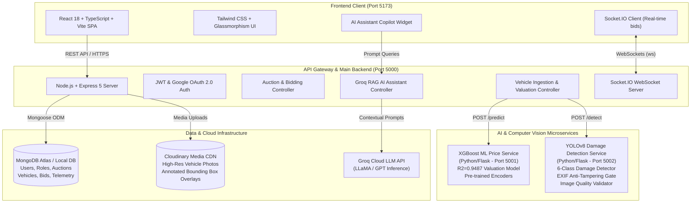
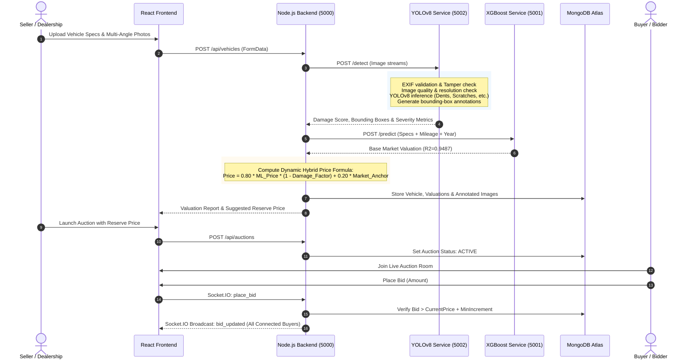

# 🚗 AI Vehicle Auction Portal

<div align="center">

[](https://reactjs.org/)
[](https://www.typescriptlang.org/)
[](https://vitejs.dev/)
[](https://tailwindcss.com/)
[](https://nodejs.org/)
[](https://expressjs.com/)
[](https://www.mongodb.com/)
[](https://www.python.org/)
[](https://ultralytics.com/)
[](https://xgboost.readthedocs.io/)
[](https://socket.io/)
[](https://groq.com/)

**An enterprise-grade, intelligent vehicle auction platform combining YOLOv8 Computer Vision damage assessment, XGBoost machine learning price estimation, dynamic hybrid pricing algorithms, real-time WebSocket bidding, and an interactive Groq RAG AI Copilot.**

[Explore Architecture](#-system-architecture) • [Workflow](#-end-to-end-workflow) • [Key Features](#-key-features) • [Quick Start](#-quick-start) • [API Reference](#-api-endpoints)

</div>

---

## 📌 Executive Summary

The **AI Vehicle Auction Portal** revolutionizes automotive remarketing and secondary market sales. Traditional vehicle auctions suffer from asymmetric information, subjective damage inspections, and volatile pricing. This platform solves these problems through an automated, end-to-end intelligence pipeline:

1. **Computer Vision Damage Assessment**: YOLOv8 model detects structural damages (dents, scratches, cracks, broken lamps, shattered glass, flat tires) from multi-angle photos with automated bounding box annotation and severity scoring.
2. **Machine Learning Valuation Engine**: Pre-trained XGBoost regression model ($R^2 = 0.9487$, $MAPE = 13.88\%$) benchmarks accurate baseline market valuations based on vehicle specifications, age, mileage, transmission, and fuel type.
3. **Dynamic Hybrid Pricing Algorithm**: Merges raw machine learning market valuations ($80\%$) with granular computer vision damage penalties ($20\%$) and regional market anchoring to generate realistic reserve and buy-now prices.
4. **Real-Time Interactive Bidding**: Powered by Socket.IO for low-latency live bid broadcasts, competitive auction rooms, anti-sniping countdowns, and instant notifications.
5. **RAG AI Automotive Assistant**: Integrated conversational assistant powered by Groq LLMs with Retrieval-Augmented Generation (RAG) over vehicle telemetry, condition reports, and bid history.

---

## 🏗️ System Architecture

The platform is designed around a decoupled, microservices-driven architecture ensuring scalability, fault isolation, and independent deployability across AI and web tiers.



---

## 🔄 End-to-End Workflow

The lifecycle of a vehicle from seller upload to auction settlement:



---

## ✨ Key Features

### 1. 🔍 YOLOv8 Computer Vision Vehicle Damage Detection
- **Multi-Class Detection**: Detects and localizes 6 distinct vehicle damage categories:
  - `Dent` (Body panels, doors, bumpers)
  - `Scratch` (Paint surface abrasions)
  - `Crack` (Windshields, bumpers, lights)
  - `Glass Shatter` (Side windows, rear screens)
  - `Lamp Broken` (Headlamps, tail lights, fog lamps)
  - `Tire Flat` (Punctures and deflation)
- **EXIF Anti-Tampering Gate**: Validates capture timestamp, camera model, and GPS data to prevent fraudulent reuse of stock internet images.
- **Image Quality Filtering**: Automated checks for blurriness (Laplacian variance), contrast, brightness extremes, and minimum resolution ($640 \times 480$).
- **Visual Bounding Boxes**: Automatically renders annotated inspection images with confidence badges.

### 2. 📈 Machine Learning Price Prediction Engine
- **Trained Model**: Optimized XGBoost regressor trained on extensive Indian & global used vehicle dataset (`cardekho_dataset.csv`).
- **Feature Pipeline**:
  - Continuous: `km_driven`, `mileage`, `engine`, `max_power`, `seats`, vehicle age.
  - Categorical: `brand`, `model`, `fuel`, `seller_type`, `transmission`, `owner`.
- **Validation Accuracy**: High correlation with real-world valuations:
  - $R^2 = 0.9487$
  - $\text{MAPE} = 13.88\%$
- **Market Anchoring**: Intelligent fallback to make-and-model historical medians when handling rare luxury or outlier configurations.

### 3. ⚖️ Dynamic Hybrid Pricing Engine
Combines statistical market valuation with physical vehicle condition:
$$\text{Final Price} = 0.80 \times \left( P_{\text{XGBoost}} \times (1 - \text{Damage Penalty}) \right) + 0.20 \times P_{\text{Market Anchor}}$$
Where:
- $\text{Damage Penalty} = \sum (\text{Severity Weight}_i \times \text{Confidence}_i \times \text{Area Ratio}_i)$
- Provides transparent valuation breakdowns to both sellers and buyers, including fair market value, recommended starting bid, and reserve threshold.

### 4. ⚡ Real-Time Bidding with WebSockets
- **Live Bid Streaming**: WebSocket powered via `Socket.IO` for millisecond-latency bid updates without page polling.
- **Dynamic Auction Rooms**: Dedicated channels per vehicle auction.
- **Sniping Protection**: Automatic 60-second time extension when bids occur in the closing moments of an auction.
- **Outbid Alerts**: Real-time push notifications when a user is outbid.

### 5. 🤖 Groq RAG AI Automotive Copilot
- **Conversational Inquiries**: Ask natural questions like *"Is this vehicle priced fairly considering the scratch on the rear bumper?"* or *"What is the estimated repair cost for the detected front dent?"*
- **Context Injection**: Retrieves real-time database telemetry (vehicle history, damage log, ML confidence metrics, market comparison) and feeds it into the Groq LLaMA / GPT inference engine.

### 6. 🛡️ Role-Based Access Control & Security
- **Three Core Personas**:
  - **Buyer**: Browse auctions, inspect AI reports, place live bids, track won vehicles.
  - **Seller / Bank / Dealership**: List vehicles, run automated damage diagnostics, review suggested reserve prices, manage active auctions.
  - **Admin**: Platform oversight, user management, audit logs, model telemetry.
- **Security Standards**: JWT token authentication, HTTP-only secure cookie session fallback, salted bcrypt password hashing, and sanitized file uploads.

---

## 💻 Tech Stack

| Layer | Technologies |
|---|---|
| **Frontend UI** | React 18, TypeScript, Vite 5, Tailwind CSS, Lucide Icons, Framer Motion |
| **Backend API** | Node.js (v20+), Express 5, Socket.IO, Mongoose, Passport.js, Multer |
| **Database & CDN** | MongoDB Atlas / Local MongoDB, Cloudinary Media CDN |
| **Machine Learning** | Python 3.10+, XGBoost, Scikit-learn, Pandas, NumPy, Pickle |
| **Computer Vision** | YOLOv8 (Ultralytics), OpenCV (`cv2`), Pillow (`PIL`), ExifRead |
| **AI Copilot (RAG)** | Groq SDK (LLaMA 3.3 / GPT-OSS), Vector retrieval embeddings |
| **DevOps & Tooling** | Docker, Docker Compose, PowerShell scripts |

---

## 📂 Project Directory Structure

```plaintext
ai-vehicle-auction-portal/
├── README.md                                  # Complete project documentation
├── docker-compose.yml                         # Full-stack container orchestration
├── START_ALL_SERVICES.bat                     # 1-Click launcher for all 4 services
├── PROJECT_OVERVIEW_REPORT.md                 # System overview & readiness audit
│
├── ai auction portal backend/                 # Node.js Express REST API & Gateway
│   ├── .env.example                           # Backend environment template
│   ├── server.js                              # Express & Socket.io server entry point
│   ├── package.json                           # Node dependencies & scripts
│   ├── controllers/                           # Business logic (Vehicles, Auctions, Bids, AI)
│   ├── models/                                # Mongoose schemas (Vehicle, Auction, User, Bid)
│   ├── routes/                                # REST API route declarations
│   ├── middleware/                            # JWT auth, role validation, multer upload
│   ├── services/                              # RAG engine, Cloudinary, pricing calculator
│   │
│   ├── ml/                                    # Microservice 1: ML Price Engine (Port 5001)
│   │   ├── app.py                             # Flask API for XGBoost valuation
│   │   ├── model.pkl                          # Pre-trained XGBoost regression model
│   │   ├── encoders.pkl                       # Categorical label encoders
│   │   └── audit_model.py                     # Accuracy validation scripts
│   │
│   └── damage-service/                        # Microservice 2: YOLOv8 CV Engine (Port 5002)
│       ├── .env.example                       # Damage service environment template
│       ├── app.py                             # Flask API for damage detection
│       ├── damage_detector.py                 # YOLOv8 inference wrapper
│       ├── exif_validator.py                  # EXIF metadata integrity validator
│       ├── image_quality.py                   # Blur, contrast, and resolution filter
│       ├── yolov8_damage.pt                   # Trained YOLOv8 model weights (6 classes)
│       └── requirements.txt                   # Python CV dependencies
│
├── ai-auction-frontend/                       # React + TypeScript + Vite SPA (Port 5173)
│   ├── .env.example                           # Frontend environment template
│   ├── index.html                             # Single page HTML entry
│   ├── package.json                           # Frontend dependencies
│   ├── vite.config.ts                         # Vite build configuration
│   ├── tailwind.config.js                     # Tailwind CSS styling tokens
│   └── src/
│       ├── App.tsx                            # Root React component & routing
│       ├── main.tsx                           # React DOM mount point
│       ├── components/                        # UI Components (Hero, Navbar, Bidding, Cards)
│       │   ├── AIAssistantWidget.tsx          # Groq RAG Copilot chat modal
│       │   ├── ImageUploadSection.tsx         # Multi-angle photo uploader
│       │   ├── VehicleCard.tsx                # Auction listing card with live timers
│       │   └── BidModal.tsx                   # Live bidding interaction modal
│       ├── pages/                             # Route views (Auctions, AddVehicle, Details, Profile)
│       ├── hooks/                             # Custom React hooks (useAuth, useSocket)
│       └── context/                           # React Context providers (AuthContext)
│
└── damage-detection/                          # Standalone YOLOv8 training workspace
    ├── data.yaml                              # Dataset class mappings
    ├── train.py                               # Model training loop
    └── test_real_vehicles.py                  # Real vehicle evaluation script
```

---

## 🚀 Quick Start Guide

### Option 1: 1-Click Launch on Windows (Recommended)

Simply double-click or run from PowerShell:

```powershell
.\START_ALL_SERVICES.bat
```

This automatically launches 4 coordinated terminal windows:
- 🟢 **MongoDB** (Port `27017`)
- 🟢 **XGBoost ML Price Service** (Port `5001`)
- 🟢 **YOLOv8 Damage Detection Service** (Port `5002`)
- 🟢 **Node.js Backend & RAG Assistant** (Port `5000`)
- 🟢 **React + Vite Frontend** (Port `5173`)

Wait ~15 seconds and visit: **`http://localhost:5173`**

---

### Option 2: Docker Compose

Ensure Docker Desktop is running, then execute:

```bash
docker-compose up --build -d
```

Services will be accessible at:
- Frontend: `http://localhost:5173`
- Backend API: `http://localhost:5000`
- MongoDB: `localhost:27017`

---

### Option 3: Manual Step-by-Step Setup

#### Step 1: Clone Repository
```bash
git clone https://github.com/dushyant1704/ai-vehicle-auction-portal.git
cd ai-vehicle-auction-portal
```

#### Step 2: Configure Environment Variables
Copy `.env.example` templates to `.env`:

```bash
# In backend
cp "ai auction portal backend/.env.example" "ai auction portal backend/.env"

# In damage service
cp "ai auction portal backend/damage-service/.env.example" "ai auction portal backend/damage-service/.env"

# In frontend
cp "ai-auction-frontend/.env.example" "ai-auction-frontend/.env"
```

Fill in your MongoDB connection string and API keys in `ai auction portal backend/.env`.

#### Step 3: Start YOLOv8 Damage Detection Service (Terminal 1)
```bash
cd "ai auction portal backend/damage-service"
pip install -r requirements.txt
python app.py
```
*Runs at `http://127.0.0.1:5002`*

#### Step 4: Start XGBoost ML Pricing Service (Terminal 2)
```bash
cd "ai auction portal backend/ml"
pip install flask scikit-learn xgboost pandas numpy
python app.py
```
*Runs at `http://127.0.0.1:5001`*

#### Step 5: Start Node.js API Gateway (Terminal 3)
```bash
cd "ai auction portal backend"
npm install
node server.js
```
*Runs at `http://localhost:5000`*

#### Step 6: Start React + Vite Frontend (Terminal 4)
```bash
cd "ai-auction-frontend"
npm install
npm run dev
```
*Runs at `http://localhost:5173`*

---

## 📡 Key REST API Endpoints

### 🔐 Authentication & Users
| Method | Endpoint | Description | Auth Required |
|---|---|---|---|
| `POST` | `/api/auth/register` | Register new user (Buyer, Bank/Seller, Admin) | No |
| `POST` | `/api/auth/login` | Authenticate user and issue JWT token | No |
| `GET` | `/auth/google` | Initiate Google OAuth 2.0 federated login | No |
| `GET` | `/api/user` | Fetch current session profile & auction statistics | Bearer Token |

### 🚗 Vehicle Management & AI Valuation
| Method | Endpoint | Description | Auth Required |
|---|---|---|---|
| `GET` | `/api/vehicles` | Fetch all vehicles with search, sort & filters | No |
| `GET` | `/api/vehicles/:id` | Fetch vehicle details, damage report & valuations | No |
| `POST` | `/api/vehicles` | Ingest vehicle, trigger AI damage inspection & ML price | Bearer Token |
| `POST` | `/api/predict-price` | Standalone price estimation for custom feature vector | No |

### 🔨 Auctions & Real-Time Bidding
| Method | Endpoint | Description | Auth Required |
|---|---|---|---|
| `GET` | `/api/auctions` | List active, scheduled, and completed auctions | No |
| `GET` | `/api/auctions/:id` | Detailed auction room status and bid history | No |
| `POST` | `/api/auctions` | Create new auction with starting price and end date | Seller / Admin |
| `POST` | `/api/bids` | Submit a competitive bid on an active auction | Bearer Token |
| `GET` | `/api/bids/my-bids` | Fetch bidding history for logged-in buyer | Bearer Token |

### 🤖 Damage Detection & Groq RAG Copilot
| Method | Endpoint | Description | Auth Required |
|---|---|---|---|
| `POST` | `/api/damage/detect` | Run YOLOv8 multi-class damage detection on images | No |
| `POST` | `/api/assistant/chat` | Multi-turn RAG query with Groq AI Copilot | Optional |
| `GET` | `/api/assistant/status` | Health check for Groq LLM and vector store | No |

---

## 📊 Machine Learning Model Specifications

### 1. XGBoost Price Estimator
- **Algorithm**: Extreme Gradient Boosting Regressor (`XGBRegressor`)
- **Objective**: `reg:squarederror`
- **Trained Samples**: ~8,000 verified vehicle sales
- **R² Score**: `0.9487`
- **Mean Absolute Percentage Error (MAPE)**: `13.88%`
- **Key Predictors**: Max power, Engine displacement, Vehicle age, Kilometers driven, Transmission type, Brand equity.

### 2. YOLOv8 Damage Classifier & Localizer
- **Architecture**: Ultralytics YOLOv8s (Small)
- **Input Resolution**: $640 \times 640$ pixels
- **Classes**:
  1. `dent`
  2. `scratch`
  3. `crack`
  4. `glass_shatter`
  5. `lamp_broken`
  6. `tire_flat`
- **Inference Speed**: ~45ms per frame on CPU, ~8ms on CUDA GPU.

---

## 🛡️ Security & Privacy Notice
- **Never commit `.env` files** containing production credentials or private keys.
- Store production MongoDB connection strings in secure secret managers.
- Image uploads undergo EXIF sanitization and duplicate perceptual hashing to prevent fraud.

---

## 👨‍💻 Author

**Dushyant Singh Chouhan**
- GitHub: [@dushyant1704](https://github.com/dushyant1704)
- Profile: [https://github.com/dushyant1704](https://github.com/dushyant1704)

---

## 🤝 Contributors

- **Kranvagn4**
  - GitHub: [@Kranvagn4](https://github.com/Kranvagn4)
  - Profile: [https://github.com/Kranvagn4](https://github.com/Kranvagn4)
- **Abhyudaya1612**
  - GitHub: [@Abhyudaya1612](https://github.com/Abhyudaya1612)
  - Profile: [https://github.com/Abhyudaya1612](https://github.com/Abhyudaya1612)

---

## 📄 License

This project is licensed under the [MIT License](LICENSE) - feel free to use, modify, and distribute for personal and commercial projects.
